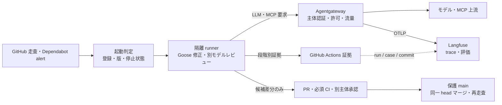

# Goose セキュリティエージェントの通信・追跡・統制

2026-11-14 時点の設計と受入境界。対象は [Goose セキュリティエージェント](../../demos/blue-team-agent/README.md) の一件ずつの依存脆弱性対応である。

## いま確認できること

| 対象 | 確認済み | このエージェントで未確認 |
| --- | --- | --- |
| Goose と Agentgateway | Blue の一件を Goose 1.54.0 → Agentgateway 1.6.0 → ローカル Ollama で試し、提案・検証と別モデルの通信を記録した。別の認証試行では JWT なし 401、未知モデル 404、提案役とレビュー役の相互モデル要求 403 を確認した。 | モデル別認可設定での全段階再試行は提案役の240秒上限で停止し、二段階レビューは未完。Blue の定期実行は現在 Ollama に直結する。Developer 拡張のローカル Shell・ファイル操作は Gateway を通らない。 |
| Agentgateway と Langfuse | Blue のモデル通信から局所 OTLP 検査受信器へ span を送信し、二段階の trace ID・親 span・モデル名を照合した。許可済み trace から限定した値だけの新しい OTLP を組む任意の中継を追加し、局所の偽受信器で本文・Tool出力が転送されないことを確認した。 | Langfuse 本体への保存・API 読戻しは未実行。現環境には本体 URL と project 鍵がない。局所の偽受信器による確認を実サービスの追跡成立と扱わない。 |
| AGT | AGT 4.1.0 core の `govern()` は、既存の通常見積で明示した資料参照 Tool 4 個の実行前判断に使っている。AgentMesh Registry へ合成 Goose ID・版・owner・権能を登録し、版違いと失効後に登録情報の照合が不一致になることをローカル実行で確認した。 | Registry の試行はメモリ内で、照合処理も試行側にある。実 Goose 起動、資格確認、Gateway、Developer 拡張、GitHub 書込への強制は未接続。AGT 4.1.0 の `cryptography<49` 要求は、公開済み修正版50.0.0以降と衝突する。 |
| GitHub 操作 | PR 候補の差分、局所の別モデルレビュー、対象 CVE の再走査、同一 head SHA を指定する保護付きマージのワークフローを実装した。 | 実 Dependabot alert からの自動選定、正式レビュー、保護 main への自動反映と反映後走査。 |

## 責任を置く場所

Agentgateway は**通過した**モデル・MCP 通信を認証・制御する。Langfuse は通信と判断経過を調べる保存先であり、Tool の許可や GitHub のマージを決定しない。AGT は明示的に接続した Tool の実行前判断と、AgentMesh の登録情報に使う。Goose の Developer 拡張はこの三者を通らないため、隔離 runner、外向き通信制限、差分範囲と検証を独立した強制条件にする。展示用 `demo.yaml` は権限台帳として使わない。

本番の提案・レビュー Job はまだローカル Ollama へ直結している。接続先だけを Gateway に変えても、同じ runner 上の Goose Developer 拡張が Ollama ポートへ直接接続でき、認可を迂回する。実行ユーザーとネットワークを分け、Goose から見える宛先を Gateway のモデルポートに限定してから、本番 Job に短命 JWT を接続する。

## 新規 Agent の登録から停止まで

Agent の作者は実装を自由に追加できる。実行時の権限は実装の自己申告だけで決めず、運用担当が登録した版と許可範囲に合わせる。

| 操作 | 実行条件と確認する結果 |
| --- | --- |
| 登録 | owner、実装版、用途、許可するモデル・MCP Tool・データ範囲、上限、期限を AgentMesh Registry に記録する。承認担当と実行担当を分ける。 |
| 起動 | 制御側が登録版・失効状態と実行体を照合し、短命の主体トークンを発行する。未登録、失効、版不一致なら起動を拒否する。現 PoC はこのうちメモリ内の登録状態照合まで。 |
| 実行 | Agentgateway がトークンから主体を確認し、モデル・MCP の許可と流量を強制する。MCP の個別操作とアプリの業務権限はそれぞれの認可で判定し、Goose の Shell は隔離 runner で制限する。 |
| 追跡 | case ID、Agent ID・版、GitHub run ID、Gateway trace ID、PR head SHA を結び、Langfuse と GitHub の結果を照合する。trace に出た要求数は修正成功の証拠にはしない。 |
| 停止 | 登録失効で新規起動と新規通信を拒否し、実行中の runner は制御側が停止する。Gateway を経由しない通信を外向き通信制限で遮断する。 |

AGT の公式制約にも、policy 未読込時の許可、Tool 監査と外部の実行結果の差、資格情報の保持が挙げられる。したがって「AGT を導入した」だけでは統制済みと判定しない。登録版の照合、Gateway の拒否、runner の停止、GitHub の実状態を個別に確認する。

依存版も採否条件に入れる。2026-11-14に、ローカルの AGT 4.1.0 配布メタデータと `pip` の解決結果で `cryptography<49.0,>=46.0.7` を確認した。一方、cryptography の[公開済み助言](https://github.com/pyca/cryptography/security/advisories/GHSA-g6cj-pr64-35w5)は修正版を50.0.0としている。今回の Registry 試行は隔離環境で行い、AGT の本番採用は依存条件の解消と再検証後に判断する。Gateway 試行の依存版は修正版の PyJWT 2.15.1 と cryptography 50.0.2 に分けた。

## 一件の追跡契約

| 値 | 発行元と用途 |
| --- | --- |
| `agentId`、登録版・policy digest、owner | 起動管理側が確定する。未登録、停止中、版不一致は起動前に拒否する。現時点では未実装。 |
| `github.run_id`、`caseId`、`baseSha` | GitHub Actions と選定段階の正本。提案・検証・レビューの JSON は `caseId` と入力 hash で連鎖する。 |
| Gateway の trace ID・要求 ID | Gateway が実際に処理した通信の観測値。`X-Playground-Run-Id` は結合用で、呼出し元が指定できる値だけを本人認証としない。 |
| PR 番号・head SHA・正式 review ID・merge SHA | GitHub API から読戻す。別モデルの `APPROVE` と GitHub 上の正式承認を別欄に置く。 |
| 段階、許否、所要時間、結果 hash | Actions 証拠と trace を照合する。prompt、patch 本文、Tool 引数、生 stdout/stderr、資格情報は送らない。 |

trace ID の一致だけで Tool の成功、業務への影響、マージ後の安全性を認定しない。各段階の実結果と GitHub の状態を別に読戻す。成功時の `review.json` は GitHub Actions が人の確認前に Artifact へ送るため、モデル生成の理由文を保存せず、SHA-256 とバイト数だけ記録する。変更要求で停止したローカル結果には理由文が残るため、公開しない。

## 2026-11-14 のローカル試行

三つの試行は同じ合成 Dependabot alert と実際の `body-parser` 修正候補を対象にした。GitHub の実 alert から自動起動した結果ではない。保存した JSON は秘密鍵、JWT、prompt、patch 本文、raw span を含まない。

| 試行 | 実測した結果 | 判定 |
| --- | --- | --- |
| [Goose 段階実行](goose-gateway-stage-run-20261114.json)（14:06–14:08 JST） | Goose が修正案を作成（95.9 秒）、検証・再走査で対象検出 0 件（20.6 秒）。Gateway ログは提案 8 要求、レビュー 3 要求を記録し、局所 OTLP で両 trace の親 span とモデル名を照合した。別モデルのレビュー回答は JSON として読めず停止した。 | `trialPassed=false`。この時点の設定は二つの JWT 主体をモデル別に分けていない。 |
| [モデル別認可](goose-gateway-auth-20261114.json)（14:21 JST） | 修正版 PyJWT 2.15.1 と cryptography 50.0.2 を使い、JWT なし 401、未知モデル 404、提案役→レビューモデル 403、レビュー役→提案モデル 403 を再確認した。モデル一覧も役ごとに一つだけ返した。 | 認可試行は成功。この設定での Goose 全段階の結果は別の実行で確認する。 |
| [モデル別認可を使った再試行](goose-gateway-second-failed-run-20261114.json)（14:20–14:24 JST） | Goose 案は構造検査で棄却され、固定手順で候補を作成した。再走査では対象検出 0 件。別 Goose は `REQUEST_CHANGES` を返し、publish 前に停止した。Gateway で役ごとのモデル拒否と両 trace を観測した。 | `trialPassed=false`。この試行は旧 Python 依存版を使用し、レビューの重複 JSON キー拒否を追加する前にレビュー処理が起動したため、受入証拠には採用しない。 |
| [修正版依存と主体別認可での再試行](goose-gateway-proposal-timeout-20261114.json)（14:29–14:33 JST） | PyJWT 2.15.1・cryptography 50.0.2で起動。JWTなし401、未知モデル404、主体間の相互モデル要求403を再確認。提案役のモデル通信8要求と局所OTLP親spanを観測した。 | 提案役Gooseは240秒の上限で停止。候補検証と別レビューには進んでいない。保存結果の`unclassified_stage_failure`は試行器の分類不足であり、原因を「時間上限」と確認して修正する。 |
| [中継実装後の認可再確認](goose-gateway-auth-final-20261114.json)（14:37 JST） | Langfuse鍵をGateway子プロセスへ渡さない環境でGatewayを起動し、JWTなし401、未知モデル404、両役のモデル越境403と役ごとの一覧を再確認した。 | `authorizationChecksPassed=true`。Gooseの提案・検証・レビューもLangfuse実送信も、この認可専用実行では行っていない。 |

局所 OTLP 受信器は既知の本文属性名を検出しなかったが、全属性・イベント値の安全性は未監査である。外部転送には受信した生spanを使わず、許可した trace と属性だけで新しいOTLPを組む。局所の偽Langfuse受信器では、本文・Tool出力を含む元spanからその値を除去して送信した。実Langfuseへの保存・読戻しは未確認である。運用担当は Gateway 記録から担当役とモデル要求を追える一方、全段階が完走していないため、自動修正の所要時間や人手削減はまだ実測できない。

## 次の受入条件

1. 同じセキュリティ案件の修正・レビューの二つのモデル要求を専用 Gateway へ通し、JWT なし拒否、許可モデル、Gateway ログと局所 OTLP span の同一 run を照合する。Developer の操作は Gateway 外と表示する。
2. AgentMesh の登録・版変更・失効を実起動前に照合し、未登録・停止中では Goose を起動しない。AGT の版と公式 API を固定し、試行結果で採否を決める。
3. Langfuse v4 の到達先と project 鍵を用意し、限定属性で再構築した OTLP を送って Observations API で同じ trace を読戻す。HTTP受理や局所の偽受信器だけでは達成としない。
4. 隔離 runner、権限を分けた GitHub 資格、main 保護を有効にして、実 alert 一件の PR 作成から同一 head マージ・再走査までを確認する。モデルレビューの揺れ、実影響、人の判断を別に記録する。

参考： [Agentgateway の観測](https://agentgateway.dev/docs/standalone/latest/documentation/observability/)、[Langfuse OTLP](https://langfuse.com/integrations/native/opentelemetry)、[AGT の制約](https://github.com/microsoft/agent-governance-toolkit/blob/v4.1.0/docs/LIMITATIONS.md)。
