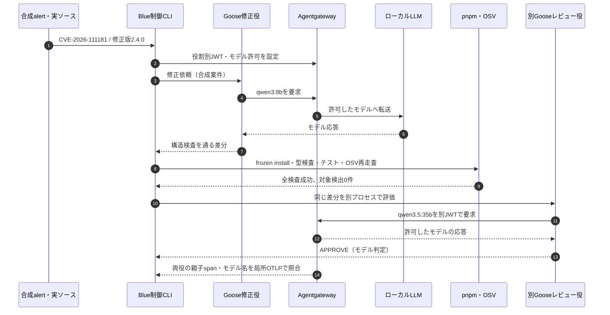

# Goose セキュリティエージェントの一件実行（2026-11-14）

**結果:** 合成 Dependabot alert と実ソース `f715deb` の `body-parser@2.3.0` を使い、15:41–15:43 JST の局所試行で、Goose 自身の修正案、固定検証・OSV 再走査、別 Goose のレビュー、Agentgateway の役割別認可と両段階の trace 照合まで通した。[成功した段階別結果](goose-gateway-final-trial-20261114.json)は `trialPassed=true` である。GitHub の自動 PR、正式承認、マージ、Langfuse 本体への保存はこの結果に含まれない。

## 実際に通った順序

Goose に提案役のモデルだけを、別レビュー役にレビューモデルだけを見せた。JWT なしは401、役を越えたモデル要求は403だった。`/no_think` は提案役のプロンプトで**要求した設定**であり、モデル内部の思考モードを直接計測した結果ではない。レビューの `APPROVE` は GitHub 上の正式承認ではない。

## 同じ案件での三試行

| 実行 | Goose の差分 | 固定検証・再走査 | 別モデル | Gateway の追跡 | 局所判定 |
| --- | --- | --- | --- | --- | --- |
| [15:33–15:36](goose-gateway-live-fallback-20261114.json) | lockfile の無関係な変更を拒否し、固定手順へ切替 | 成功、対象0件 | `APPROVE` | 両役を照合 | 不合格。採用候補は Goose 自身の差分ではない。 |
| [15:36–15:38](goose-gateway-no-think-unlinked-20261114.json) | Goose 自身が正規差分を作成 | 成功、対象0件 | `APPROVE` | レビュー役のモデルspanが欠落 | 不合格。Gateway の通信ログだけでは追跡完了としない。 |
| [15:41–15:43](goose-gateway-final-trial-20261114.json) | Goose 自身が同じ正規差分を作成 | 成功、対象0件 | `APPROVE` | 両役のモデルspanと親spanを照合 | **局所試行は合格。** |

最後の試行で観測した段階時間は提案97.1秒、検証17.3秒、別レビュー25.2秒、全体約141秒。API往復と Tool 操作を含む時間で、純粋なモデル計算時間ではない。三試行の差から `/no_think` の速度改善は確認できない。局所 OTLP では既知の本文属性名を観測しなかったが、全属性の安全性を証明したわけではない。

## 本人が確認できる修正差分と GitHub の走査

[修正候補 PR #16](https://github.com/yomote/tech-playground/pull/16)の `git diff --binary` の SHA-256 は、最後の局所試行で Goose が作った差分の `af4e75d75b58667e1fa8881e6be83af48e39e09027117b3bfa6dc4f950626f88` と一致した。PR #16 は先に**手動公開**したドラフトであり、今回のエージェントが自動作成した PR ではない。

GitHub の [未修正側 CVE watch](https://github.com/yomote/tech-playground/actions/runs/43562566174) と [PR #16 側 CVE watch](https://github.com/yomote/tech-playground/actions/runs/43557434118) の Artifact は ZIP と SARIF の SHA-256 を照合した。両方とも PR 検査用 merge commit の走査であり、結果行の差は `body-parser@2.3.0` の `CVE-2026-111181` 一件だった。これは main 上の実 Dependabot alert を自動選定した証拠ではない。

## まだ接続していない範囲

- AGT 4.1.0 の AgentMesh Registry は別途メモリ内で登録・版違い・失効を再確認したが、この実行の Goose 起動は Registry で許可していない。
- Langfuse の URL と project 鍵が環境になく、局所 OTLP の先は検査受信器である。Langfuse 本体への保存・読戻しは未確認。
- 現行の定期 Job は Ollama 直結。Goose の Shell から Ollama へ直接到達できない隔離 runner、実 alert の取得、別 GitHub 主体の正式承認、保護 main の自動マージとマージ後再走査は未実行。GitHub の `allow_auto_merge` は false、ruleset は空で、classic branch protection は権限不足で確認できなかった。

今回の局所試行のコードは `gateway_trial.py` SHA-256 `67a05527e843ce51706b71cd88257831ab32a634c12b3a2c12522b5ba9ca740d`、`security_loop.py` SHA-256 `d9a0ef4c3dced21e85ac0bc498622201658ee323074fb035594cf2b5ca079914` を使用した。成果物に秘密鍵・JWT・prompt・patch本文・raw span は保存しない。
